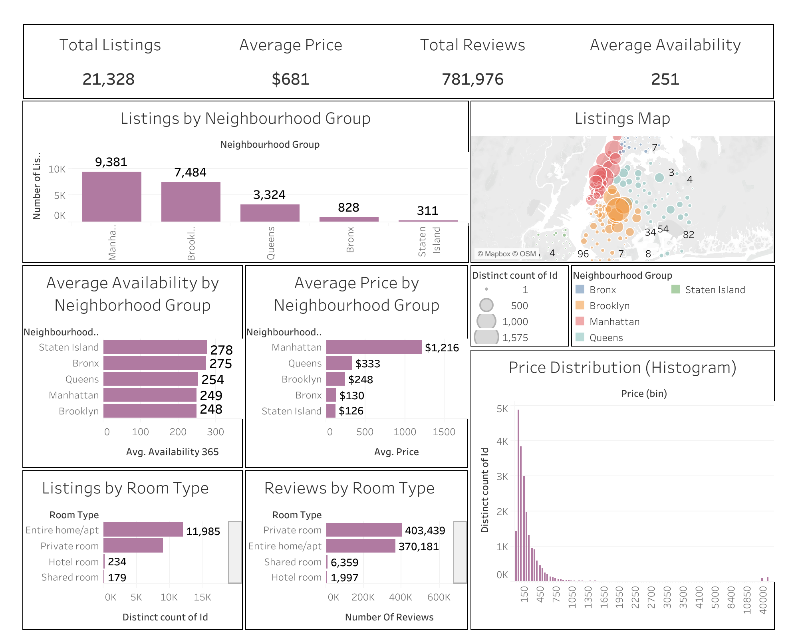

# Airbnb NYC Market Dashboard (Tableau)

I built an interactive Tableau dashboard from a Kaggle NYC Airbnb dataset to see where listings, prices, and reviews concentrate across the five boroughs. The goal was to turn raw listing data into **market intelligence** that supports pricing, investment, and targeting decisions.

 **Tools:** Tableau · Calculated Fields · KPI Design · Market Segmentation · Data Storytelling  
 **Source:** Kaggle (NYC Airbnb listings, cleaned file of 21,328 listings)

---

**[Interactive Tableau Dashboard](https://public.tableau.com/views/AirbnbNewyork_17631581845800/Dashboard?:embed=y)**

---

## What I Built
A Tableau dashboard that answers:
- Which boroughs hold the most Airbnb listings?
- How do typical prices compare across boroughs?
- Which room types get the most reviews?
- Where are listings concentrated on the map?
- What does the price distribution look like, and where are the outliers?

---

## What I Did
- Worked from a cleaned dataset of 21,328 listings (one row per listing, no duplicates)
- Created calculated fields to track KPIs: price, availability, and review activity
- Used **median** price alongside the average, because a small group of extreme prices stretches the average
- Designed a clean dashboard layout for quick interpretation
- Built interactive visuals for borough-level comparison and geographic exploration

---

## Insights That Matter
- **Supply is concentrated.** Manhattan and Brooklyn hold 79% of listings (16,865 of 21,328).
- **Manhattan is the priciest borough, by a smaller gap than the averages suggest.** Median price is $230 in Manhattan, $130 in Brooklyn, $103 in Queens, $99 on Staten Island, and $94.50 in the Bronx ($154 across all of NYC). The averages are much higher ($681 overall, $1,216 in Manhattan) because 593 listings are priced at $1,000 or more, with a top price of $50,104.
- **Brooklyn has the most review activity.** It has 326,915 reviews versus 275,407 in Manhattan, with about 1,900 fewer listings. That is roughly 44 reviews per listing in Brooklyn versus 29 in Manhattan.
- **Private rooms get more attention than their share.** Private rooms are about 42% of listings and 52% of reviews. Entire homes and apartments are about 56% of listings and 47% of reviews.
- **Availability is similar across boroughs.** It ranges from 248 to 278 days out of 365, slightly higher in the Bronx and Staten Island. Availability depends on how hosts set their calendars, so I do not read it as demand.
- **Most listings are for longer stays.** About 81% require a minimum stay of 30 nights or more.

**Limits to keep in mind:** reviews are a rough signal of demand, not bookings (about 30% of listings have none). Prices are listed prices, and some very high ones may be monthly rates rather than nightly.

---

## Why This Matters
This dashboard can help:
- Hosts compare their price to the borough median, not the average
- Investors see which boroughs have the most supply and review activity
- Operators track supply concentration and engagement
- Teams spot pricing outliers before they distort a report
